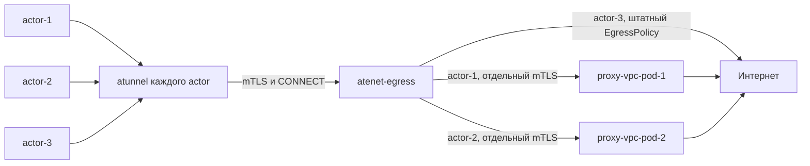

# Пример использования egress proxy

Пример использует локальный стенд и показывает, как запрос к `ya.ru` проходит из `actor-1` через `proxy-vpc-pod-1`. В командах ниже используется отдельный kubeconfig стенда.

```sh
cd /Users/korolkovnikita/projects/not_my/substrate
export KUBECONFIG="$PWD/setup-vpc-proxy/.work/kubeconfig"
export PATH="$PWD/setup-vpc-proxy/.work/bin:$PATH"

kubectl-ate --context kind-substrate-vpc-proxy \
  get actor actor-1 actor-2 actor-3 -a ate-demo-egress -o yaml
```

С чистого стенда весь пример поднимается командой:

```sh
make -C setup-vpc-proxy all
```

Внутри этой команды ресурсы появляются в таком порядке:

1. `bootstrap` устанавливает Substrate и запускает `ate-setup deploy demo egress`. Demo создаёт Kubernetes namespace `ate-demo-egress` и [WorkerPool egress](../../demos/egress/egress.yaml.tmpl) с gVisor и меткой `workload: egress`. Также создаётся одноимённый atespace в Substrate API. Namespace содержит worker Pods, atespace содержит actors, их шаблон и политики.
2. Demo собирает [Go-приложение egress](../../demos/egress/main.go), публикует образ в локальный registry и подставляет digest в [исходный шаблон](../../demos/egress/egress-template.yaml.tmpl). Результат для проверенного стенда сохранён в [actorstemplates.yaml](actorstemplates.yaml). Этот ActorTemplate задаёт контейнер, метку подходящих workers, порт readiness probe и набор доверенных CA. Demo регистрирует шаблон в Substrate API и ждёт его golden snapshot.
3. [create-actors.sh](../scripts/create-actors.sh) создаёт три экземпляра шаблона через `kubectl-ate create actor`, сохраняет назначенные сервером UID, добавляет каждому [исходную EgressPolicy](../manifests/actor-policy.yaml.tmpl) и вызывает `resume`, если actor ещё не запущен. Сокращённый экспорт этих объектов сохранён в [actors.yaml](actors.yaml).
4. [routes.py](../scripts/routes.py) записывает реальные UID в `.work/routes.yaml`. При deploy этот файл попадает в ConfigMap `ate-system/vpc-proxy-routes`, который читает ext-proc gateway.

Посмотреть зарегистрированный шаблон и worker pool:

```sh
kubectl-ate --context kind-substrate-vpc-proxy \
  get actor-template egress -a ate-demo-egress -o yaml
kubectl --context kind-substrate-vpc-proxy -n ate-demo-egress \
  get workerpool egress -o yaml
```

`actors.yaml` служит примером вывода Substrate API. При ручном создании в уже подготовленном atespace, где этих имён ещё нет, используй CLI:

```sh
kubectl-ate --context kind-substrate-vpc-proxy create actor actor-1 -a ate-demo-egress --template egress
kubectl-ate --context kind-substrate-vpc-proxy create actor actor-2 -a ate-demo-egress --template egress
kubectl-ate --context kind-substrate-vpc-proxy create actor actor-3 -a ate-demo-egress --template egress
```

Сам шаблон регистрируется командой `kubectl-ate --context kind-substrate-vpc-proxy create actor-template -f setup-vpc-proxy/docs/actorstemplates.yaml` при наличии atespace и указанного образа в registry. Штатный `bootstrap` выполняет этот шаг автоматически. Для полного цикла с policy, запуском actors и сохранением UID используй `make -C setup-vpc-proxy all`.

Gateway выбирает маршрут по atespace, имени и UID. UID назначает Substrate при создании actor. Конфигурация маршрутов стенда выглядит так:

```yaml
apiVersion: vpc-proxy.substrate.local/v1alpha1
kind: ActorEgressRoutes
routes:
  - actor:
      atespace: ate-demo-egress
      name: actor-1
      uid: c2f8fdf1-c611-4b50-8a76-bf7724cb402d
    mode: proxy
    cluster: vpc_proxy_1
  - actor:
      atespace: ate-demo-egress
      name: actor-2
      uid: ede80a2a-7d2c-4e60-a202-363607548d08
    mode: proxy
    cluster: vpc_proxy_2
  - actor:
      atespace: ate-demo-egress
      name: actor-3
      uid: b46e1beb-f174-4f33-a614-cb29c0d6c9a0
    mode: direct
```



DNS relay в worker проверяет имя по EgressPolicy actor. После DNS-разрешения atunnel открывает CONNECT к gateway для конкретного IP и порта. Gateway проверяет идентичность actor и выбирает маршрут. Для `actor-1` Envoy открывает второй CONNECT по mTLS к `proxy-vpc-pod-1`. Connector проверяет сертификат клиента и адрес назначения, затем соединяется с сайтом. При HTTPS TLS-сессия с сайтом проходит внутри туннелей.

Обычный `curl ya.ru -v` запускается на Mac и идёт через его сеть. В демонстрации `curl --noproxy '*' ya.ru -v` отправил HTTP-запрос на порт 80 и получил редирект Yandex CAPTCHA:

```text
* Connected to ya.ru (77.88.55.242) port 80
> GET / HTTP/1.1
> Host: ya.ru
< HTTP/1.1 302 Moved temporarily
< X-Yandex-Captcha: captcha
< Location: http://ya.ru/showcaptcha?...
```

Чтобы повторить запрос через actor, сохрани исходную policy и сделай копию для редактирования:

```sh
kubectl-ate --context kind-substrate-vpc-proxy get egress-policy actor-1 \
  -a ate-demo-egress -o yaml > /tmp/actor-1-policy-before.yaml
cp /tmp/actor-1-policy-before.yaml /tmp/actor-1-policy-demo.yaml
```

В копии добавь `ya.ru` к `hostnames` существующих правил HTTP и TLS, сохранив `metadata.uid` и `metadata.version`. На исходном стенде эти правила выглядят так после правки:

```yaml
rules:
  - http:
      hostnames: [example.com, ya.ru]
      ports:
        numbers: [80]
  - tlsPassthrough:
      hostnames: [example.com, ya.ru]
      ports:
        numbers: [443]
```

Примени policy и запусти проксирование demo endpoint на локальный порт 18001:

```sh
kubectl-ate --context kind-substrate-vpc-proxy update egress-policy actor-1 \
  -a ate-demo-egress -f /tmp/actor-1-policy-demo.yaml

kubectl-ate --context kind-substrate-vpc-proxy \
  proxy actor actor-1 18001:80 -a ate-demo-egress
```

В другом терминале выполни запрос. Для аналога `curl ya.ru -v` укажи `http://ya.ru/` в поле `url`. Для HTTPS используй команду ниже:

```sh
curl --noproxy '*' -v http://127.0.0.1:18001/ \
  -H 'Content-Type: application/json' \
  --data '{"url":"https://ya.ru/","http1":true}'
```

Здесь `curl -v` показывает обмен с локальным endpoint. Запрос к `ya.ru` выполняет Go HTTP client внутри actor. Статус сайта возвращается в JSON-поле `statusCode`. Если сразу после обновления policy видишь `lookup ya.ru ... no such host`, повтори запрос после обновления DNS policy cache worker, которое занимает до пяти секунд.

В проверенном запуске и HTTP, и HTTPS вернули `statusCode: 302`. Логи gateway и connector показали:

```text
actor-1 → vpc_proxy_1 → proxy-vpc-pod-1 → 77.88.44.242:80
actor-1 → vpc_proxy_1 → proxy-vpc-pod-1 → 77.88.55.242:443
```

Посмотреть события своего запуска:

```sh
kubectl --context kind-substrate-vpc-proxy -n ate-system \
  logs deployment/atenet-egress -c ext-proc --since=5m
kubectl --context kind-substrate-vpc-proxy -n vpc-proxy \
  logs deployment/proxy-vpc-pod-1 --since=5m
```

Для возврата исходной policy заново выгрузи текущий YAML. Перенеси в него исходный блок `rules` из `/tmp/actor-1-policy-before.yaml`, сохранив актуальную `metadata.version`, и выполни `update egress-policy` с этим файлом. Останови локальный proxy командой Ctrl+C. После проверенного запуска исходная policy была восстановлена.
